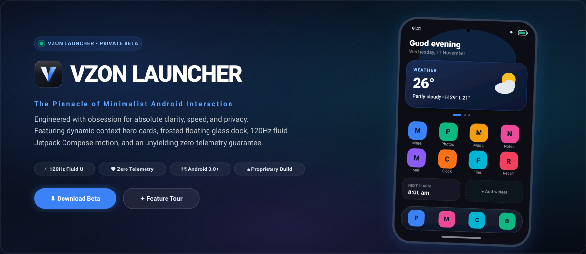
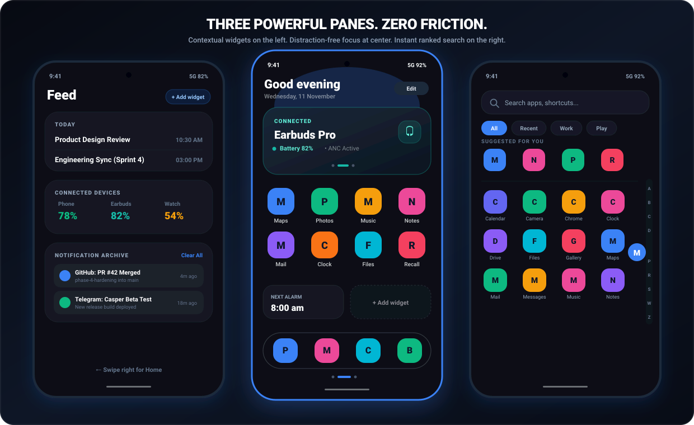
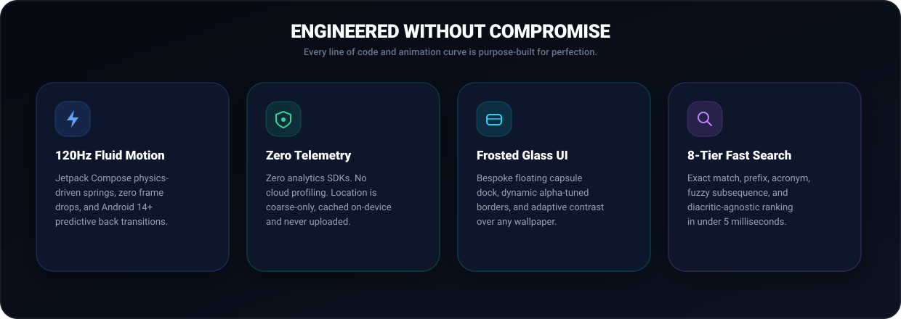
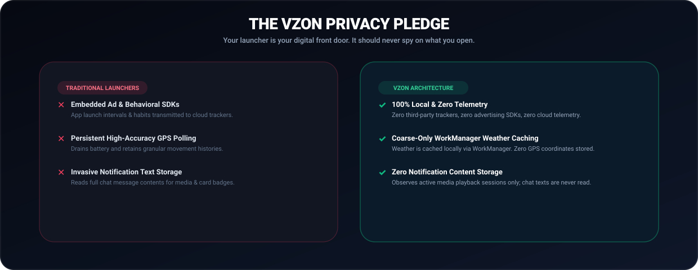

  

    

  
  
  
  
  

    

  <h3>The Pinnacle of Minimalist Android Interaction.</h3>

  

    <strong>Vzon Launcher</strong> is a radical reimagination of the Android home screen. Designed for discerning individuals who value calm minimalism over chaotic feeds, intelligent glanceability over notification clutter, and absolute on-device privacy over corporate telemetry.
  

  

    <a href="#-what-vzon-stands-for"><strong>Explore Philosophy</strong></a> •
    <a href="#-visual-showcase"><strong>Visual Showcase</strong></a> •
    <a href="#-the-dynamic-hero-stack"><strong>Hero Cards</strong></a> •
    <a href="#-the-zero-telemetry-guarantee"><strong>Privacy Pledge</strong></a> •
    <a href="#-download--installation"><strong>Download Beta</strong></a> •
    <a href="#-community--feedback"><strong>Community</strong></a>
  

---

## 🧭 What Vzon Stands For

Modern smartphones have evolved into attention-harvesting machines. Default launchers bombard you with uninvited news carousels, algorithmic suggestions, advertisement banners, and notification badges designed to create perpetual anxiety.

**Vzon Launcher was created to reclaim your digital front door.**

<table>
  <tr>
    <td width="50%">
      <h3>🕊️ Digital Calm & Intentionality</h3>
      
Your home screen should be a sanctuary, not a billboard. Vzon strips away algorithmic distractions, presenting an unblemished canvas that encourages deliberate, purposeful interaction every time you unlock your device.

    </td>
    <td width="50%">
      <h3>⚡ 120Hz Fluid Compose Motion</h3>
      
Built from scratch using modern Jetpack Compose. Every spring curve, card swipe, drawer expansion, and predictive back gesture operates with native 120 FPS fluid physics—delivering an unmatched tactile responsiveness.

    </td>
  </tr>
  <tr>
    <td width="50%">
      <h3>💎 Frosted Glassmorphism</h3>
      
Refined translucent acrylic materials, floating pill docks, ambient edge sheens, and live background blur shaders create a cohesive aesthetic that dynamically adapts to both dark and vibrant wallpapers.

    </td>
    <td width="50%">
      <h3>🛡️ Zero Telemetry & Sovereignty</h3>
      
100% local, on-device computation. No tracking SDKs, no behavioral analytics, no ad beacons, and no cloud data harvesting. Your private app habits, location, and files remain strictly yours.

    </td>
  </tr>
</table>

---

## 📱 Visual Showcase

  

 

Vzon organizes your mobile universe into three ergonomically distinct panes:

### 1. 📰 The Intelligent Feed (Swipe Left)
A centralized hub for contextual widgets and notification management.
- **At-a-Glance Telemetry Header:** Real-time date, next active system alarm, and cached temperature.
- **Connected Devices Hub:** Live battery percentages for your phone, connected earbuds, and smartwatch.
- **Persistent Notification Archive:** An on-device notification history widget that stores recent alerts so you never lose a dismissed message. Includes a one-tap *Clear All* action.
- **Modular Widget Engine:** Add, drag-to-reorder, and resize custom widgets with height presets and a 5-second undo snackbar.

### 2. 🏠 The Minimalist Home Screen (Center)
A focused launchpad calibrated for zero friction.
- **Good Evening / Greeting Header:** Dynamic contextual greetings with subtle typography.
- **The Dynamic Hero Stack:** A swipeable, peek-enabled carousel displaying live weather, Bluetooth audio telemetry, active media playback, and upcoming matches.
- **Collision-Proof 4x2 App Grid:** Drag-and-drop icon arrangement with boundary clamping, item swap physics, and long-press shortcut menus.
- **The Floating Glass Dock:** An iconic frosted glass pill floating above the navigation bar housing your 4 most essential everyday tools with tactile haptic feedback.

### 3. ⚡ The Supercharged App Drawer (Swipe Right or Up)
Instant access to your entire app library without cognitive strain.
- **8-Tier Ranked Search Engine:** Type just one or two characters to instantly locate apps using exact, prefix, acronym, or fuzzy subsequence matching.
- **Category Filter Chips:** Seamlessly isolate apps into `All`, `Recent`, `Work`, and `Play` filters.
- **Private Suggested Apps Row:** On-device private frequency tracker surfaces the apps you need before you even search.
- **Draggable Alphabet Fast-Scroller:** Tactile vertical scrub bar with haptic ticks and a floating letter magnification bubble (`M`, `P`, `S`, etc.).
- **Work Profile Support:** Dedicated personal and work profile tab switcher with active work badges.

---

## 💫 The Dynamic Hero Stack

  

 

Instead of static, lifeless widgets, Vzon introduces the **Hero Card Stack**—context-aware visual cards that emerge and adapt based on your environment:

| Card | Description | Architecture Highlights |
|---|---|---|
| **🌦️ Live Weather** | Dynamic atmospheric artwork representing day, night, clear, rainy, and twilight conditions. Shows temperature, high/low, humidity, and sunrise/sunset. | Powered by [Open-Meteo](https://open-meteo.com/) (zero API key, zero user tracking). Refreshes every 30 minutes via Android WorkManager or instantly on tap. |
| **🎧 Earbuds & Bluetooth** | Displays live battery levels for Left earbud, Right earbud, and Charging Case alongside Active Noise Cancellation (ANC) status. | Dynamically surfaces only when Bluetooth audio hardware is paired. Reflection-safe battery reads with graceful fallbacks. |
| **🎵 Now Playing Media** | Extracted dynamic color palettes from the active album cover, live seekable scrubber progress bar, and play/pause/skip controls. | Integrates via Android MediaNotificationListener. Observes audio playback sessions without storing notification text. |
| **🏏 Live & Upcoming Matches** | Live fixture tracking for International Cricket (Tests, ODIs, T20Is), Indian Premier League (IPL), and Valorant Champions Tour (VCT). | Stadium floodlight artwork, team flags, countdown badges ("In 2h 15m"), and disk-cached fixture data for instant offline launch. |

---

## 🛠️ Engineered Without Compromise

  

 

### 🎛️ Live Settings Preview Studio
Tired of guessing what a launcher setting will look like? Vzon Launcher includes a **real-time visual preview canvas** embedded directly into the settings suite:
- Adjust icon scales, drawer column counts, dock slot counts, and label visibility with instant live previews.
- Toggle between dark frosted acrylic and high-contrast OLED black themes.
- Fine-tune gesture assignments (swipe down for notifications, double-tap to sleep, pinch to edit).
- Export and import your entire home configuration (dock apps, pinned pages, widget lists) as a clean, portable JSON file.

### ⚡ 8-Tier Intelligent Search Engine
Searching for an application shouldn't feel like a database query. Vzon implements an ultra-fast in-memory ranking pipeline executing in **under 5 milliseconds**:
1. **Tier 1:** Exact case-insensitive match (`"cam"` → **Camera**)
2. **Tier 2:** Prefix match (`"spo"` → **Spotify**)
3. **Tier 3:** Word prefix match (`"lab"` → **The Labs App**)
4. **Tier 4:** Acronym & initials match (`"ytm"` → **YouTube Music**)
5. **Tier 5:** Diacritic-insensitive substring (`"cafe"` → **Café**)
6. **Tier 6:** Subsequence fuzzy match (`"ph"` → **Phone**, **Photos**)
7. **Tier 7:** Package name fallback (`"com.whatsapp"` → **WhatsApp**)
8. **Tier 8:** Historical on-device launch frequency boost

---

## 🛡️ The Zero-Telemetry Guarantee

  

 

### Why Android Permissions Are Requested

Vzon Launcher adheres strictly to the principle of least privilege. Every requested permission serves an explicit, user-facing function:

| Permission | Technical Requirement | Privacy Protection Guarantee |
|---|---|---|
| `INTERNET` | Fetches live weather conditions from Open-Meteo and sports fixtures. | **Zero telemetry.** No user analytics, device identifiers, or tracking beacons are ever transmitted. |
| `ACCESS_COARSE_LOCATION` | Resolves local weather data for your general area. | **No GPS coordinates stored.** Only coarse coordinates are queried; exact GPS is never requested or logged. |
| `QUERY_ALL_PACKAGES` | Enumerate installed applications to populate home screen and drawer. | **100% on-device.** App lists and launch frequencies are stored solely in local encrypted DataStore. |
| `BLUETOOTH_CONNECT` | Reads connected earbuds battery rings and noise-cancelling status. | Isolated behind reflection-safe helper routines; active only during audio connection. |
| `BIND_APPWIDGET` | Allows you to pin external Android widgets to your home screen and feed. | Managed via native Android `AppWidgetHost`; widget state remains completely local. |
| `EXPAND_STATUS_BAR` | Enables swipe-down gesture to open the system notification shade. | Standard Android system control; reads no notification contents. |
| `Notification Access` *(Settings)* | Enables the Now Playing media hero card and notification archive widget. | **No message reading.** Only the active media playback session and basic notification metadata are monitored. |

---

## 📥 Download & Installation

Vzon Launcher is currently distributed via our **Private Beta Channel**.

### Prerequisites
- **Supported OS:** Android 8.0 Oreo (API 26) through Android 16 (API 36).
- **Recommended OS:** Android 13+ for full 120Hz spring physics and predictive back animations.
- **Hardware:** Compatible with all ARM64-v8a and armeabi-v7a Android smartphones and tablets.

### Installation Steps
1. Navigate to the **[Releases](https://github.com/SeNsXD/Vzon-Launcher/releases)** page.
2. Download the latest signed release APK (`Vzon-Launcher-v1.x.apk`).
3. Open the APK on your device and tap **Install** (allow *Install from unknown sources* if prompted).
4. Press your device's **Home button**, select **Vzon Launcher**, and choose **Always**.
5. Follow the quick onboard prompt to enable coarse location for Weather and notification access for Media controls.

---

## 🔒 Closed-Source & Proprietary Notice

> **Important Notice:** Vzon Launcher is a **proprietary, closed-source application** designed and maintained by [xdNOT Labs](https://github.com/SeNsXD). 
> 
> The source code is not publicly licensed or distributed. This repository serves as our official public presence for:
> - Publishing signed production and beta APK releases.
> - Hosting comprehensive design showcases and release documentation.
> - Tracking user feedback, bug reports, and community feature requests.
> - Engaging with beta testers and design enthusiasts.
> 
> *Pull requests containing code will be politely closed. However, issue reports, design feedback, translation requests, and community discussions are warmly welcomed!*

---

## 💬 Community & Feedback

We welcome your input to shape the future of Vzon Launcher:

- 🐛 **Found a bug?** Submit a report using our [Bug Report Form](https://github.com/SeNsXD/Vzon-Launcher/issues/new?template=bug_report.yml).
- 💡 **Have a feature idea?** Propose a concept through our [Feature Request Form](https://github.com/SeNsXD/Vzon-Launcher/issues/new?template=feature_request.yml).
- 💬 **Join Discussions:** Chat with fellow users and share home setups in [GitHub Discussions](https://github.com/SeNsXD/Vzon-Launcher/discussions).
- 📢 **Telegram Channel:** Join [@xdNOT_Labs](https://t.me/xdNOT_Labs) for release alerts, beta drops, and design previews.

---

## 👥 Credits & Design System

- **Design & Engineering:** Crafted with obsession by **[SeNsXD](https://github.com/SeNsXD)** at **xdNOT Labs**.
- **Weather Telemetry:** Powered by the open-source [Open-Meteo API](https://open-meteo.com/).
- **Typography:** Set in [Inter](https://rsms.me/inter/) by Rasmus Andersson.
- **Icons & Graphics:** Handcrafted vector iconography and bespoke hero card graphics.

 

  Copyright © 2026 xdNOT Labs • All Rights Reserved.
   
  Designed for those who appreciate the beauty of less.

